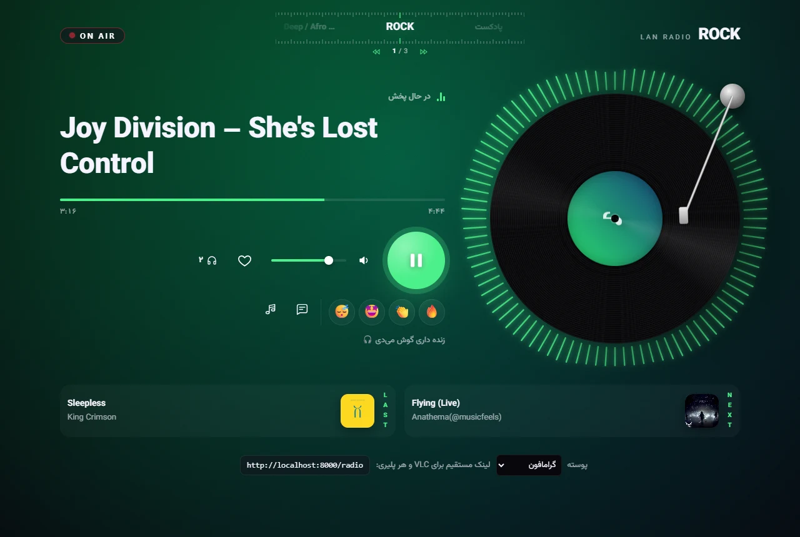
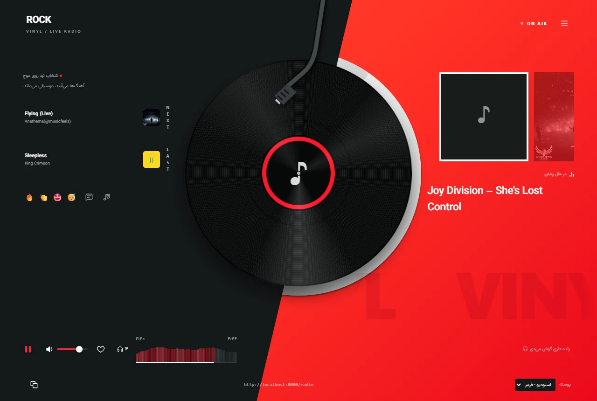

# رادیوی شبکه‌ی داخلی · LAN Radio

> **English summary:** a self-hosted radio station for your local network. Liquidsoap plays a folder of music,
> Icecast streams it, and nginx serves one address that opens a listener page (two designs: vinyl and studio) in a browser and the
> plain audio stream in VLC or phone players. Includes an admin panel (pause, skip, reorder, queue, library), live
> broadcasting (the panel can put the computer's own sound or a microphone on air from the browser; BUTT, Mixxx or
> ffmpeg can connect too) and a low-latency web player (~2.5 s from the panel to the listener's ears). UI is in
> Persian. Designed and built by **Claude** (Anthropic's AI model) in a Claude Code session.

یک ایستگاه رادیویی کامل برای شبکه‌ی داخلی: موزیک‌های یک پوشه را پخش زنده می‌کند، یک **پنل مدیریت** برای کنترل پخش دارد، و یک **صفحه‌ی شنونده** که هر کسی روی شبکه با مرورگر باز کند، رادیو را با یک ظاهر رادیویی (صفحه‌ی گرام چرخان، کاور آهنگ، ویژوالایزر) گوش می‌دهد.

> طراحی و پیاده‌سازی: **Claude** (مدل هوش مصنوعی Anthropic)، در یک گفتگو با Claude Code، به درخواست [@DanialAzimiSh](https://github.com/DanialAzimiSh).

صفحه‌ی شنونده دو پوسته دارد که از انتخاب «پوسته» پایین صفحه عوض می‌شوند:

| گرامافون (`vinyl`، پیش‌فرض) | استودیو (`studio`) |
|---|---|
|  |  |

| آدرس | چیست | برای چه کسی |
|---|---|---|
| `http://<IP>:8000/radio` | در مرورگر: صفحه‌ی شنونده · در VLC و پلیرها: خود صدا | شنونده‌ها |
| `http://<IP>:8000/stream` | همیشه خود صدا (برای پلیرهایی که خودشان را مرورگر معرفی می‌کنند) | پلیرها |
| `http://<IP>:8002` | نمایشگر پایگاه داده (فقط‌خواندنی، با رمز `DB_PASSWORD`)؛ SQLite درگاه شبکه ندارد و این راه «وصل شدن» به آن است | مدیر |
| `http://<IP>:8001` | پنل مدیریت (با رمز `PANEL_PASSWORD`): داشبورد، لیست پخش، کتابخانه، پخش زنده، پیام‌ها، درخواست‌ها، آهنگ‌های ارسالی، تنظیمات | مدیر ایستگاه |
| `<IP>:8005` mount `/live` | ورودی پخش زنده برای BUTT، Mixxx، ffmpeg (رمز `LIVE_PASSWORD`) | گوینده / DJ |
| `http://<IP>:8000/admin/` | پنل خود Icecast (نام کاربری و رمز ادمین از `.env`) | مدیر |

`<IP>` همان `RADIO_HOST` در فایل `.env` است.

---

## راه‌اندازی

**پیش‌نیاز:** Docker (روی ویندوز Docker Desktop) و یک پوشه موزیک (`mp3`، `m4a`، `ogg`، `flac`، `wav`، `aac`، `opus`).

1. پروژه را بگیرید:
   ```
   git clone https://github.com/DanialAzimiSh/lan-radio.git
   cd lan-radio
   ```
2. `.env.example` را به `.env` کپی کنید و پرش کنید:
   - `RADIO_HOST`: IP همین کامپیوتر روی شبکه (ویندوز: `ipconfig`).
   - `MUSIC_DIR`: پوشه‌ی موزیک، مثلاً `D:/Music`.
   - `MAX_CHANNELS`: سقف کل کانال‌ها با احتساب کانال اصلی؛ عدد صحیح مثبت، پیش‌فرض `6` (یک کانال اصلی و پنج کانال دیگر). برای اعمال تغییر دوباره `docker compose up -d` اجرا کنید؛ `restart` مقدار تازهٔ env را اعمال نمی‌کند. پیش از کاهش سقف، کانال‌های مازاد را حذف کنید.
   - رمزها: فقط حروف و عدد. `PANEL_PASSWORD` رمز ورود به پنل مدیریت است و `LIVE_PASSWORD` رمز برنامه‌های پخش زنده.
3. یک زیرپوشه به اسم `radio` داخل پوشه‌ی موزیک بسازید. لیست پخش و وضعیت رادیو آنجا ذخیره می‌شود.
4. بالا بیاورید:
   ```
   docker compose up -d
   ```
5. `http://<IP>:8001` را باز کنید و از «کتابخانه» آهنگ به لیست پخش اضافه کنید.
6. لینک `http://<IP>:8000/radio` را به شنونده‌ها بدهید.

**فایروال ویندوز:** ورودی پورت‌های 8000، 8001 و 8005 باید مجاز باشد. قانون «Docker Desktop Backend» معمولاً این کار را می‌کند. اگر دستگاه‌های دیگر وصل نمی‌شوند، اول اینجا را چک کنید. اگر شبکه دستگاه‌ها را از هم جدا کند (client isolation، رایج در وای‌فای مهمان)، هیچ تنظیمی روی این سیستم کمکی نمی‌کند.

**بعد از ری‌استارت سیستم:** هر سه کانتینر `restart: always` دارند، پس به شرطی که Docker با سیستم بالا بیاید، رادیو هم خودش بالا می‌آید.

---

## معماری

```
                         Docker (docker compose)
 ┌──────────────────────────────────────────────────────────────────────────────┐
 │                                                                              │
 │  MUSIC_DIR  ──(فقط خواندنی)──►  radio  (Liquidsoap)                           │
 │  MUSIC_DIR/radio ──(نوشتنی)──►   │  playlist.m3u + radio-state.json          │
 │                                  │                                           │
 │                                  ├── :8001  پنل مدیریت + API کنترل ◄──────────┼── مدیر
 │                                  ├── :8005  ورودی پخش زنده /live ◄────────────┼── پنل (مرورگر) / BUTT / Mixxx
 │                                  │                                           │
 │                                  └── MP3 ۳۲۰kbps ──►  icecast  (بدون پورت عمومی)│
 │                                                          ▲                   │
 │                     radio-web (nginx) :8000 ─────────────┘                   │
 │                       ├─ /radio   مرورگر ← صفحه‌ی شنونده  |  پلیر ← صدا       │◄── شنونده‌ها
 │                       ├─ /stream  همیشه صدا                                  │
 │                       ├─ /listen/ فایل‌های صفحه (HTML، live.js، فونت)        │
 │                       └─ /api/now، /cover، /like، /react، /message ← از Liquidsoap │
 └──────────────────────────────────────────────────────────────────────────────┘
```

**کیفیت صدا:** همه‌ی شنونده‌ها یک جریان MP3 با ۳۲۰ کیلوبیت (بالاترین کیفیت MP3) می‌گیرند. این کیفیت اصلی فایل نیست: Liquidsoap هر آهنگ را باز می‌کند، کراس‌فید و پخش زنده را روی آن اعمال می‌کند و دوباره یک جریان واحد می‌سازد. عدد را در `output.icecast(%mp3(bitrate=...))` در `radio.liq` عوض کنید و کانتینر `radio` را ری‌استارت کنید. هر شنونده حدود ۴۰ کیلوبایت بر ثانیه مصرف می‌کند.

| کانتینر | ایمیج | کار |
|---|---|---|
| `radio` | `savonet/liquidsoap:v2.3.3` | موتور پخش: انتخاب آهنگ بعدی، crossfade، توقف، رمزگذاری MP3، و سرور HTTP پنل مدیریت |
| `icecast` | `infiniteproject/icecast` | سرور پخش: صدا را از Liquidsoap می‌گیرد و به همه‌ی شنونده‌ها می‌رساند |
| `radio-web` | `nginx:1.27.5-alpine` | درِ ورودی پورت 8000: تصمیم می‌گیرد چه کسی صفحه ببیند و چه کسی صدا بگیرد |

## فایل‌ها

| فایل | چیست | بعد از تغییرش |
|---|---|---|
| `.env.example` | الگوی تنظیمات (IP، پوشه‌ی موزیک، رمزها). کپی‌اش، یعنی `.env`، منتشر نمی‌شود | `docker compose up -d` |
| `docker-compose.yml` | تعریف چهار کانتینر (Icecast، رادیو، nginx، نمایشگر پایگاه داده)، پورت‌ها و پوشه‌ها | `docker compose up -d` |
| `radio.liq` | اسکریپت Liquidsoap: منطق پخش + API | `docker restart radio` |
| `panel/` | پنل مدیریت: `index.html` (چیدمان و بخش‌ها)، `panel.css`، `js/core.js` (وضعیت مشترک)، `js/sections.js` (کامپوننت هر بخش)، `js/live.js` (پخش زنده)، `vendor/alpine.min.js` | فقط رفرش مرورگر |
| `panel/vendor/` | Alpine.js 3.14.9 (MIT، روی همین سرور؛ بدون اینترنت هم کار می‌کند) | — |
| `nginx.conf` | مسیریابی پورت 8000 | `docker restart radio-web` |
| `listen/themes/vinyl/index.html` | پوسته‌ی «گرامافون» (پیش‌فرض) | فقط رفرش مرورگر |
| `listen/themes/studio/` | پوسته‌ی «استودیو»: `index.html`، `studio.css`، `studio.js` (کاور آهنگ فعلی و دو آهنگ بعدی، اسم خواننده در پس‌زمینه) | فقط رفرش مرورگر |
| `listen/player.js`، `listen/player.css` | پخش، داده‌ی آهنگ، ویژوالایزر و استایل پایه‌ی مشترک همه‌ی پوسته‌ها (❤️، واکنش، پیام، درخواست) | فقط رفرش مرورگر |
| `listen/notes.js`، `listen/notes.css` | توضیحات و نکته‌های آهنگ فعلی که مدیر نوشته | فقط رفرش مرورگر |
| `listen/live.js` | پلیر کم‌تأخیر، مشترک بین صفحه‌ی شنونده و پنل مدیریت | فقط رفرش مرورگر |
| `listen/fonts/` | فونت وزیرمتن و مجوزش (روی همین سرور، تا بدون اینترنت هم کار کند) | — |
| `listen/likes.js` | دکمه‌ی ❤️ صفحه‌ی شنونده و انیمیشن‌هایش (GSAP) | فقط رفرش مرورگر |
| `listen/feedback.js` | واکنش‌های ایموجی و کادر «پیام به رادیو» در صفحه‌ی شنونده | فقط رفرش مرورگر |
| `listen/requests.js` | درخواست آهنگ و ارسال فایل در صفحه‌ی شنونده | فقط رفرش مرورگر |
| `listen/notices.js`، `listen/notices.css` | اعلان‌های مدیر زیر فهرست‌های پخش یا اعلان گذرای پایین صفحه | فقط رفرش مرورگر |
| `listen/ruler-carousel.js`، `listen/channel-links.js`، `listen/channels.css` | انتخاب کانال: کاروسل خط‌کش‌دار کوچک وسط بالای صفحه، همیشه باز (کشیدن، کلیک روی اسم، دکمه‌های قبلی/بعدی یا کلیدهای چپ و راست؛ با یک کانال دیده نمی‌شود)؛ جریان صدا داخل همان صفحه عوض می‌شود | فقط رفرش مرورگر |
| `listen/lists.js`، `listen/lists.css` | دو بُرد زیر پلیر: کلمه‌ی عمودی NEXT یا LAST کنار کاور یک آهنگ؛ کلیک روی بُرد فهرست کامل را زیرش باز می‌کند | فقط رفرش مرورگر |
| `listen/compact.css` | ظاهر ساده‌ی کنترل‌ها: دکمه‌ی پخش بزرگ، واکنش‌ها ایموجی رنگی، پیام و درخواست فقط آیکون، تعداد شنونده با آیکون هدفون | فقط رفرش مرورگر |
| `listen/vendor/` | GSAP 3.15 با پلاگین Physics2D (روی همین سرور) | — |
| `docs/screenshots/` | عکس‌های همین README | — |
| `package.json`، `eslint.config.mjs` | فقط ابزار توسعه: `npm run lint` اسکریپت‌های صفحه‌ی شنونده را بررسی می‌کند (بخش «بررسی کد») | — |
| `sync-playlist.ps1` | اختیاری، ویندوز: شورتکات‌هایی را که داخل `MUSIC_DIR/radio` گذاشته‌اید به ته لیست اضافه می‌کند | — |

داده‌ها داخل پوشه‌ی موزیک‌اند، نه کنار کد:
- `MUSIC_DIR/radio/playlist.m3u`: ترتیب پخش. هر خط یک آهنگ، نسبت به همان پوشه (`../Pop/song.mp3`). با یک ویرایشگر متن هم می‌شود عوضش کرد و رادیو در کمتر از ۱۰ ثانیه تغییر را می‌خواند.
- `MUSIC_DIR/radio/radio-state.json`: حالت پخش، توقف و جای ترتیب. بعد از ری‌استارت، رادیو از همان آهنگ ادامه می‌دهد و اگر متوقف بوده، متوقف می‌ماند.
- `MUSIC_DIR/radio/hidden.txt`: آهنگ‌هایی که اسم و کاورشان از شنونده‌ها مخفی است. هر خط یک مسیر نسبت به پوشه‌ی موزیک (`Pop/song.mp3`). از پنل یا با ویرایشگر متن عوض می‌شود.
- **`radio.db`** (SQLite: ورودهای پنل و لایک‌ها) در پوشه‌ی موزیک نیست، در volume داکر `radio_data` است، چون قفل فایل SQLite روی پوشه‌های ویندوز قابل اعتماد نیست. پشتیبان‌گیری و برگرداندن:
  ```
  docker cp radio:/var/cache/liquidsoap/radio.db ./radio-backup.db     # پشتیبان
  docker cp ./radio-backup.db radio:/var/cache/liquidsoap/radio.db     # برگرداندن، بعد: docker restart radio
  ```

---

## هر بخش چطور کار می‌کند

### ۱. موتور پخش (`radio.liq`)

Liquidsoap یک زبان اسکریپت مخصوص رادیو است. زنجیره‌ی صدا این است:

```
صف «بعدی» ─┐
            ├─ pick() ─► auto (یک آهنگ از قبل آماده) ─► سوییچ توقف ─► crossfade ─► Icecast
ترتیب لیست ─┘
```

- **`pick()`**: هر وقت آهنگ بعدی لازم باشد صدا زده می‌شود. اول صف «بعدی پخش شود» را نگاه می‌کند، بعد ترتیب لیست را بر اساس حالت: `normal` (به ترتیب، با `cursor`)، `randomize` (شافل، با `bag`)، `random` (هر بار تصادفی).
- **یک آهنگ از قبل آماده می‌شود** (prefetch) تا بین آهنگ‌ها مکث نباشد. پس وقتی از پنل ترتیب یا حالت را عوض می‌کنید، آن آهنگ آماده‌شده با وضعیت قدیمی انتخاب شده است. هر انتخاب یک برچسب دارد که می‌گوید از کجا آمده (`radio_from`، `radio_index`). `give_back()` با همین برچسب اثرش را دقیقاً برمی‌گرداند (آهنگ به صف برمی‌گردد یا `cursor` به عقب)، و بعد انتخاب از نو انجام می‌شود.
- **شمارنده‌ی `version`**: اگر وسط آماده شدن یک آهنگ از پنل تغییری بدهید، آن انتخاب نیمه‌کاره دور ریخته می‌شود و از نو انجام می‌شود (`touch()` در هر تغییر).
- **سوییچ توقف قبل از crossfade است، نه بعد از آن.** وقتی بعد از آن بود، زدن پشت‌سرهم توقف و رد کردن، crossfade را قفل می‌کرد و صدا روی سکوت گیر می‌کرد.
- **`crossfade_seconds`** (بالای فایل): طول محو شدن آهنگ‌ها در هم. بخش «تأخیر» را ببینید.
- **پنل مدیریت هم از همین اسکریپت سرو می‌شود** (`harbor.http.register`). پوشه‌ی `panel/` (`index.html` در هر درخواست از دیسک خوانده می‌شود و بقیه‌ی فایل‌ها با `harbor.http.static` سرو می‌شوند) تغییرش ری‌استارت نمی‌خواهد؛ فقط رفرش مرورگر. خود صفحه و فایل‌هایش داده‌ای ندارند و بدون ورود باز می‌شوند.

### ۲. پنل مدیریت (`panel/`)

یک برنامه‌ی کوچک با **Alpine.js** (۴۴ کیلوبایت، بدون build و بدون Node در زمان اجرا). نوار کناری بخش‌ها را جدا می‌کند و آدرس هر بخش در `#/library`، `#/requests` و … می‌ماند (رفرش همان بخش را باز می‌کند). در موبایل نوار کناری یک کشو می‌شود.

| گروه | بخش | کار |
|---|---|---|
| پخش | 🏠 داشبورد | بازسازی نمای شنونده داخل خود پنل: صفحهٔ پخش، اعلان‌ها، توضیحات آهنگ و دو فهرست؛ کنترل‌های مدیریتی کنار هر بخش، شمارنده‌ها و صف «بعدی» |
| | 📜 لیست پخش | ترتیب پخش با کشیدن، صف «بعدی پخش شود»، مخفی/پخش/بعدی هر ردیف |
| | 🎵 کتابخانه | جستجو، فیلتر پوشه/مخفی‌ها/لایک‌شده‌ها، افزودن به لیست |
| | 🎙 پخش زنده | از مرورگر (صدای ویندوز یا میکروفون) یا برنامه‌های پخش |
| | 🔔 جینگل و ساعت | فایل‌های جینگل و اعلام ساعت، جینگل خودکار و پخش دستی (بخش ۱۴) |
| | 📻 کانال‌ها | کانال اصلی با شناسهٔ ۰؛ ساخت و حذف کانال در زمان اجرا تا سقف `MAX_CHANNELS`؛ انتخاب کانال برای مدیریت همهٔ بخش‌های پنل |
| شنونده‌ها | 📢 اعلان‌ها | اعلان‌های صفحه‌ی شنونده با عکس اختیاری (بخش ۱۶) |
| | ✉ پیام‌ها | صندوق پیام |
| | 🎶 درخواست‌ها | درخواست‌های در انتظار، پذیرش خودکار |
| | ⬆ آهنگ‌های ارسالی | گوش دادن، تأیید یا رد فایل‌های شنونده‌ها |
| سیستم | 📊 آمار | شمارنده‌ها از SQLite و نمودار از Prometheus (بخش ۱۵) |
| | ⚙ تنظیمات | فهرست آهنگ‌ها برای شنونده، حالت پذیرش، پیوند نمایشگر پایگاه داده |

**ساختار کد:** `core.js` یک store مشترک است (وضعیت `/api/status` که هر ۲ ثانیه می‌آید، تابع `call()` که ۴۰۱ و خطا را یک‌جا مدیریت می‌کند، `post()`). هر بخش یک کامپوننت در `sections.js` (یا `live.js`) است که فقط حالت خودش را نگه می‌دارد. **بخش جدید اضافه کردن:** یک `<section x-show="tab === 'اسم'" x-data="اسم">` در `index.html`، یک لینک در نوار کناری، یک کامپوننت `Alpine.data('اسم', …)`، و اسمش را در `TITLES` بالای `sections.js` بگذار.

**Home:** نمای شنونده مستقیماً در DOM پنل ساخته می‌شود و دادهٔ عمومی `/api/now` را می‌خواند؛ iframe نیست. نام مخفی، اعلان‌ها، توضیحات و فهرست‌ها با همان داده‌ای نمایش داده می‌شوند که به شنونده می‌رسد. کنترل‌های هر بخش از API مدیریتی استفاده می‌کنند. برای عکس اعلان و مدیریت کامل درخواست‌ها و آهنگ‌ها، بخش‌های تخصصی پنل در دسترس‌اند.

**چرا Alpine؟** پنل چند بخش دارد و به‌زودی بیشتر می‌شود، ولی هنوز فقط فرم و فهرست است. Alpine به‌جای رشته‌سازی HTML با `innerHTML` (که قبلاً می‌کردیم) الگوی اعلانی می‌دهد، ولی React/Vue لازم ندارد. بدون build، بدون `node_modules` در اجرا و به همان سادگی «ویرایش فایل و رفرش». صفحه‌ی شنونده عمداً Alpine ندارد: یک صفحه‌ی انیمیشنی است که با GSAP و کد ساده بهتر می‌شود.

### ۳. درِ ورودی پورت 8000 (`nginx.conf`)

ظرفیت Icecast و محدودیت ساخت کانال در Liquidsoap هر دو از `MAX_CHANNELS` در `.env` می‌آیند (پیش‌فرض ۶، شامل کانال اصلی). پنل ظرفیت را از `/api/channels/limits` می‌گیرد. مقدار خالی از پیش‌فرض استفاده می‌کند و مقادیر نامعتبر مانند صفر، منفی یا متن هنگام راه‌اندازی رد می‌شوند. سقف پیش‌فرض خود Icecast فقط ۲ است و باعث رد اتصال کانال سوم با خطای ۴۰۳ و سپس خطای ۴۰۴ برای شنونده می‌شد.

**چندکاناله:** همهٔ صداها کانال‌اند؛ موسیقی فعلی کانال ۰ با آدرس `/radio` و `/stream` است. در پنل تا سقف `MAX_CHANNELS` می‌توان کانال ساخت یا حذف کرد. هر کانال خروجی Icecast در `/channel-<id>` دارد و شنونده از همان صفحه و طرح‌های اصلی، در نشانی `/channel/<id>`، کانال را عوض می‌کند. انتخاب کانال بالای پنل مدیریت، داشبورد و بخش‌های مربوط به همان کانال را نشان می‌دهد. فهرست آهنگ، صف، حالت پخش، توقف، پخش زنده، یکسان‌سازی بلندی صدا، جینگل خودکار و دستی، اعلام ساعت، اکولایزر، اعلان‌ها، لایک و واکنش، پیام، درخواست، آپلود و آمار هر کانال جداست. کتابخانهٔ آهنگ، فایل‌های جینگل، فایل‌های اعلام ساعت، توضیحات فایل و فهرست آهنگ‌های مخفی مشترک‌اند. فهرست و حالت پخش کانال‌های تازه در SQLite ذخیره می‌شود و پس از راه‌اندازی مجدد برمی‌گردد.

یک آدرس (`/radio`) دو کار می‌کند، بر اساس هدر `Accept` درخواست:
- مرورگری که صفحه را باز می‌کند `Accept: text/html` می‌فرستد ← صفحه‌ی شنونده (یکی از طرح‌های `listen/themes/`) را می‌گیرد.
- VLC، تگ `<audio>`، و پلیرهای گوشی چنین هدری نمی‌فرستند ← خود صدا از Icecast می‌آید.

از پورت 8000 فقط چند endpoint عمومی Liquidsoap دیده می‌شوند (`/api/now`، `/api/cover` و برای نوشتن `/api/like`، `/api/react`، `/api/message`). API کنترل فقط روی 8001 است.

### ۴. صفحه‌ی شنونده (`listen/themes/`)

صفحه دو **پوسته** دارد (عکس‌ها بالای همین README):
- `vinyl` (گرامافون، پیش‌فرض): صفحه‌ی چرخان با کاور، بازوی پیک‌آپ، اکولایزر دایره‌ای دور صفحه.
- `studio` (استودیو): طرح مشکی و قرمز با صفحه‌ی گرامافون بزرگ، بازوی فلزی، کاور واقعی آهنگ و دو آهنگ بعدی، و ویژوالایزر نواری پایین صفحه. در موبایل عناصر زیر هم چیده می‌شوند.

از انتخاب «پوسته» پایین صفحه می‌شود بین آن‌ها جابه‌جا شد؛ کانال انتخاب‌شده حفظ می‌شود و انتخاب در کوکی مرورگر می‌ماند. طرح «رادیو لامپی» (`tube`) حذف شد؛ اگر روزی برگردد، در تاریخچه‌ی git هست. ابزارک‌ها (لایک، واکنش، پیام، درخواست)، پخش (`player.js`، `live.js`) و استایل پایه (`player.css`) مشترک‌اند، پس پوسته‌ی جدید فقط ظاهر است و build نمی‌خواهد.

- **پوسته‌ی تازه:** پوشه‌ی `listen/themes/<اسم>/index.html` بساز با همان `id`های ابزارک‌ها، `player.css` و اسکریپت‌های مشترک را مثل دو پوسته‌ی فعلی لینک کن، یک `<option>` به انتخاب «پوسته» هر دو صفحه اضافه کن و اسمش را در دو `map` اول `nginx.conf` اضافه کن؛ بعد `/radio?theme=<اسم>` آن را برای همان مرورگر انتخاب می‌کند و در کوکی نگه می‌دارد. طرح پیش‌فرض ایستگاه خط `default vinyl;` در `map $cookie_theme` است.
- **اکولایزر دایره‌ای:** نیمه‌ی حلقه (بالا تا پایین، دو طرف قرینه) ۴۰ هرتز تا ۱۴ کیلوهرتز است، لگاریتمی: بالا بیس (حدود ۴۰ هرتز)، دو پهلو صدای میانی (حدود ۷۵۰ هرتز)، پایین زیر (حدود ۱۲ تا ۱۴ کیلوهرتز). باندهای بالاتر کمی تقویت می‌شوند چون موسیقی آنجا انرژی کمتری دارد. (قبلاً نگاشت خطی بود: بیس فقط بالای حلقه بود و نیمه‌ی پایین روی ۸ تا ۱۶ کیلوهرتز می‌افتاد که تقریباً تکان نمی‌خورد.)

- **داده:** هر ۳ ثانیه `/api/now` (آهنگ فعلی، بعدی، تاریخچه) و هر ۱۰ ثانیه `/status-json.xsl` (تعداد شنونده از Icecast).
- **کاور:** `/api/cover?f=...` کاور داخل فایل MP3 را با `file.cover` در Liquidsoap درمی‌آورد. آهنگ بی‌کاور یک طرح رنگی می‌گیرد که از روی اسم فایل ساخته می‌شود.
- **رنگ صفحه:** تابع `accentFromImage` کاور را روی یک canvas کوچک می‌کشد، رنگ غالب و پررنگ را پیدا می‌کند، و متغیر CSS `--accent` را عوض می‌کند. دکمه‌ی پخش، نوار پیشرفت و ویژوالایزر همه از همین متغیرند.
- **ویژوالایزر:** با Web Audio (`AnalyserNode`) طیف صدای واقعی را می‌خواند و ۹۶ میله دور صفحه‌ی گرام روی `<canvas>` می‌کشد. روی آیفون غیرفعال است، چون آنجا Web Audio پخش در پس‌زمینه را قطع می‌کند. جایش یک حرکت آرام نمایش داده می‌شود.
- **صفحه‌ی قفل گوشی:** Media Session API اسم و کاور آهنگ را به سیستم‌عامل می‌دهد.

### ۵. پخش کم‌تأخیر (`listen/live.js`)

با `<audio src=...>` معمولی، خود مرورگر تصمیم می‌گیرد چقدر بافر کند. کروم حدود ۵ ثانیه جمع می‌کند و تا آخر همان‌قدر عقب می‌ماند. `live.js` استریم را خودش با `fetch` می‌گیرد و تکه‌تکه به **Media Source Extensions** می‌دهد. اینطوری صفحه تصمیم می‌گیرد: پخش را فوراً شروع کند، حدود ۰.۸ ثانیه پشت آخرین تکه‌ی رسیده بماند، و اگر قطعی شبکه آن را بیشتر از ۲ ثانیه عقب انداخت، به جلو بپرد. اگر اتصال قطع شود، هر ۲.۵ ثانیه دوباره وصل می‌شود. روی آیفون (که MSE برای MP3 ندارد) همان پخش معمولی می‌ماند.

### ۶. پخش زنده

```
موزیک (auto) ──┐
                ├─ سوییچ زنده ─► سوییچ توقف ─► crossfade ─► Icecast
:8005/live ─► buffer() ┘
```

- تا وقتی یک منبع به `:8005/live` وصل است، صدای آن جای موزیک پخش می‌شود. موزیک در این مدت خوانده نمی‌شود، پس بعد از قطع اتصال از همان ثانیه ادامه پیدا می‌کند. صفحه‌ی شنونده «🔴 پخش زنده» نشان می‌دهد.
- **دکمه‌ی «پخش زنده» در پنل:** مرورگر صدای کل ویندوز را می‌گیرد (اشتراک «کل صفحه» با تیک «Share system audio») یا میکروفون را، با `MediaRecorder` به Opus تبدیل می‌کند، و تکه‌های ۲۵۰ میلی‌ثانیه‌ای را با WebSocket (پروتکل `webcast` در Liquidsoap) می‌فرستد. رمز این اتصال یک رمز یک‌بار مصرف است که پنل از `/api/live/token` می‌گیرد، پس `LIVE_PASSWORD` هیچ وقت به مرورگر نمی‌رسد.
  - مرورگرها گرفتن صدا را فقط روی `localhost` یا HTTPS اجازه می‌دهند. این دکمه فقط وقتی کار می‌کند که پنل را روی **خود کامپیوتر رادیو** با `http://localhost:8001` باز کنید.
  - موقع پخش صدای ویندوز، روی همان کامپیوتر به رادیو گوش ندهید، وگرنه صدای رادیو دوباره ضبط می‌شود. پنل پخش «گوش دادن» خودش را خودکار قطع می‌کند.
- **برنامه‌های پخش** (BUTT، Mixxx، ffmpeg) از هر دستگاهی: سرور Icecast، پورت `8005`، mount `/live`، کاربر `source`، رمز `LIVE_PASSWORD`.
- **کلید «اجازه‌ی پخش زنده»:** خاموش که باشد، منبع وصل‌شده روی آنتن نمی‌رود و اتصال جدید رد می‌شود. دکمه‌ی «قطع منبع» عمداً وجود ندارد (بخش تله‌ها را ببینید).
- **بافرها:** ورودی harbor خودش حدود ۱ ثانیه (`live_buffer_seconds`) بافر می‌کند تا لرزش شبکه را جذب کند. `buffer()` به آن یک clock جدا می‌دهد و به اندازه‌ی crossfade به‌اضافه‌ی نیم ثانیه ذخیره دارد. تأخیر پخش زنده تا گوش شنونده حدود ۴.۴ ثانیه است.

### ۷. مخفی کردن آهنگ از شنونده‌ها

با دکمه‌ی 👁/🙈 کنار هر آهنگ در پنل (یا «🙈 مخفی کن» برای آهنگ در حال پخش)، شنونده‌ها به‌جای اسم و کاور آن آهنگ فقط `hidden_title` («موسیقی»، بالای `radio.liq`) می‌بینند. صدا عوض نمی‌شود؛ فقط هر نشانی از اینکه چه آهنگی است برداشته می‌شود:

| کجا | چه می‌شود |
|---|---|
| صفحه‌ی شنونده (`/api/now`) | آهنگ فعلی، «بعدی» و «اخیراً پخش شد»: بدون مسیر فایل (اسم فایل معمولاً اسم آهنگ است)، بدون تگ، با طرح خنثی |
| `/api/cover` | ۴۰۴ برای آهنگ مخفی، حتی اگر کسی مسیرش را بداند |
| VLC، پلیر گوشی، صفحه‌ی وضعیت Icecast | متادیتای خود استریم با `metadata.map(update=false, ...)` کامل پاک می‌شود و فقط `hidden_title` می‌ماند |
| صفحه‌ی قفل گوشی (Media Session) | فقط `hidden_title`، بدون کاور |

اگر آهنگی وسط پخش مخفی یا آشکار شود، متادیتای تازه همان لحظه با `insert_metadata` در استریم فرستاده می‌شود. پنل مدیریت همه‌چیز را مثل قبل نشان می‌دهد. فیلتر «🙈 فقط مخفی‌ها» در کتابخانه فهرستشان را نشان می‌دهد.

### ۸. ورود به پنل

پنل مدیریت رمز `PANEL_PASSWORD` (از `.env`) را می‌خواهد. خود صفحه (`GET /`) داده‌ای ندارد و عمومی است؛ هر API مدیریتی بدون ورود `401` می‌دهد و صفحه با دیدن آن فرم ورود را نشان می‌دهد.

- بعد از ورود، یک کوکی `radio_session` (توکن تصادفی ۴۸ حرفی از `/dev/urandom`، `HttpOnly`، `SameSite=Strict`) ۳۰ روز معتبر است. ورودها در `radio.db` ذخیره می‌شوند و بعد از ری‌استارت هم می‌مانند.
- **عوض کردن `PANEL_PASSWORD`** (و `docker compose up -d`) همه‌ی مرورگرها را از پنل خارج می‌کند.
- ۵ رمز اشتباه در یک دقیقه فرم را تا آخر آن دقیقه قفل می‌کند. پشت Docker Desktop همه‌ی مرورگرها از یک آدرس می‌آیند، پس این قفل برای همه است.
- رمز یک‌بار مصرف پخش زنده هم فقط به پنل واردشده داده می‌شود.

### ۹. لایک ❤️

- **صفحه‌ی شنونده:** دکمه‌ی ❤️ کنار کنترل صدا برای آهنگ در حال پخش، و یک قلب کوچک کنار هر آهنگ «اخیراً پخش شد».
- **انیمیشن‌ها** (`listen/likes.js`، با [GSAP](https://gsap.com)):
  - **لایک:** قلب له می‌شود و با فنر برمی‌گردد. یک هاله و دو موج حلقه‌ای پخش می‌شوند. ۲۰ ذره (قلب و نقطه‌ی طلایی) با فیزیک واقعی (Physics2D: سرعت، زاویه، جاذبه) منفجر می‌شوند. «+۱» بالا می‌آید و چند قلب شناور اوج می‌گیرند.
  - **آهنگ لایک‌شده:** قلب با ریتم ضربان (دوتایی) می‌تپد.
  - **لایک بقیه:** وقتی شنونده‌های دیگر لایک می‌کنند، برای همه قلب‌های شناور بالا می‌آیند و عدد می‌پرد.
  - **کاهش حرکت:** با «کاهش حرکت» (`prefers-reduced-motion`) فقط رنگ عوض می‌شود.
  - **ساخت انیمیشن‌ها:** همه یک بار داخل `gsap.matchMedia` ساخته می‌شوند و با هر لمس فقط از اول پخش می‌شوند (با مقادیر تصادفی تازه)، نه اینکه هر بار انیمیشن تازه ساخته شود.
- **هر شنونده یک بار:** هر مرورگر یک شناسه‌ی ناشناس تصادفی (بدون ثبت‌نام) در `localStorage` دارد و برای هر آهنگ فقط یک بار حساب می‌شود. لایک بعد از بستن صفحه هم سر جایش می‌ماند.
- **شناسه‌ی پخش، نه اسم فایل:** شنونده‌ها شناسه‌ی پخش (`id` در `/api/now`) را لایک می‌کنند، نه اسم فایل را. آهنگ مخفی هم لایک می‌گیرد و اسمش لو نمی‌رود. فقط ۱۲ پخش آخر قابل لایک‌اند.
- **پنل:** تعداد ❤️ کنار آهنگ در حال پخش و هر ردیف، و فیلتر «❤️ لایک‌شده‌ها» در کتابخانه (پرطرفدارها اول).
- **محدودیت نرخ:** nginx لایک را به ۵ در ثانیه (با جهش ۲۰) محدود می‌کند؛ پشت Docker Desktop این سقف برای کل ایستگاه است. کسی که عمداً شناسه‌ی جدید بسازد می‌تواند چند بار لایک کند؛ برای یک رادیوی داخلی این قابل قبول است.

### توضیحات و نکته‌های جالب آهنگ

در پنل، از «کتابخانه» کنار هر آهنگ «درباره» را بزنید. یک توضیح کوتاه و چند نکته بنویسید؛ هر نکته در یک خط جدا. «ذخیره» متن‌ها را در جدول `notes` از `radio.db` ثبت می‌کند. برای پاک کردن، هر دو کادر را خالی و ذخیره کنید. هر بخش حداکثر ۲۰۰۰ نویسه دارد.

وقتی آن آهنگ پخش می‌شود، کارت «دربارهٔ این آهنگ» در هر دو طرح صفحهٔ شنونده ظاهر می‌شود. متن‌ها برای آهنگ مخفی، جینگل و پخش زنده نمایش داده نمی‌شوند. API مدیریتی `/api/notes` پشت رمز پنل است؛ شنونده فقط متن آهنگ فعلی را از `/api/now` می‌گیرد. تغییر `radio.liq` و مهاجرت جدول `notes` با راه‌اندازی دوبارهٔ کانتینر `radio` اعمال می‌شود.

### ۱۰. واکنش‌ها و پیام به رادیو (`listen/feedback.js`)

دو چیز جدا، چون یکی عمومی و زنده است و دیگری خصوصی:

| | شنونده چه می‌کند | چه کسی می‌بیند | ماندگاری |
|---|---|---|---|
| **واکنش** 🔥 👏 🤩 😴 | یک لمس روی ایموجی | همه: ایموجی با انیمیشن از همان دکمه بالا می‌آید. هیچ عددی نمایش داده نمی‌شود | شمارش هر آهنگ در SQLite (`reactions`) فقط برای مدیر؛ شمارش زنده‌ی هر بار پخش فقط در حافظه |
| **پیام به رادیو** | کادر یک‌خطی با اسم اختیاری (نظر، انتقاد، درخواست آهنگ) | فقط مدیر، در «✉ پیام شنونده‌ها» در پنل | در SQLite (`messages`) تا مدیر حذفش کند |

- **بدون ورود و بدون broker:** مثل لایک، شناسه‌ی ناشناس مرورگر (`localStorage`) کافی است. واکنش بقیه هم با همان `/api/now` هر ۳ ثانیه می‌رسد: صفحه فقط رشد شمارش زنده‌ی همین بار پخش را انیمیشن می‌کند، و با پخش دوباره‌ی همان آهنگ از صفر شروع می‌شود (حس لایو). سرویس پیام‌رسان جدا لازم نیست.
- **سقف‌ها:** از هر شنونده برای هر آهنگ و هر نوع واکنش حداکثر ۵۰ لمس در SQLite ذخیره می‌شود (`reaction_cap`)؛ لمس‌های بیشتر باز هم برای همه انیمیشن می‌شوند ولی ذخیره نمی‌شوند. پیام حداکثر ۲۸۰ حرف و اسم ۳۰ حرف. هر شنونده هر ۳۰ ثانیه یک پیام، و در کل ایستگاه ۲۰ پیام در دقیقه (چون شناسه‌ی مرورگر قابل جعل است، سقف کلی ترمز اصلی است). nginx هم واکنش را به ۱۰ در ثانیه و پیام را به ۱ در ثانیه محدود می‌کند.
- **پیام با آهنگ می‌آید:** هر پیام همراه اسم آهنگی که آن لحظه روی آنتن بود ذخیره می‌شود (یا «🎙 پخش زنده»)، حتی اگر آهنگ مخفی باشد؛ مدیر اسم واقعی را می‌بیند. چون پیام‌ها عمومی نیستند، اسم آهنگ مخفی لو نمی‌رود.
- **پنل:** کارت «✉ پیام شنونده‌ها» با شمارنده‌ی جدیدها، «خوانده شد»، «حذف»، «همه را خوانده کن» و «پاک کردن خوانده‌ها». کنار تعداد لایک آهنگ در حال پخش، واکنش‌ها هم نشان داده می‌شوند. صندوق فقط وقتی دوباره خوانده می‌شود که تعداد پیام‌های خوانده‌نشده عوض شود.
- **کامنت عمومی ساخته نشد:** نیاز به مدیریت دارد و می‌تواند اسم آهنگ مخفی را لو بدهد. در `ROADMAP.md` مانده است.

---

### ۱۱. درخواست آهنگ و ارسال فایل (`listen/requests.js`)

دکمه‌ی «🎵 درخواست آهنگ» زیر واکنش‌ها یک کادر باز می‌کند.

| | شنونده چه می‌کند | چه اتفاقی می‌افتد |
|---|---|---|
| **از کتابخانه** | اسم یا خواننده را جستجو می‌کند و «درخواست» را می‌زند | در پنل «🎵 درخواست آهنگ» می‌نشیند. مدیر «بعدی پخش کن» را بزند، آهنگ به صف «بعدی» می‌رود |
| **در کتابخانه نیست** | «اسمش را برای مدیر بفرست» (حداکثر ۱۲۰ حرف) | همان کارت پنل، به شکل یادداشت 📝 (مدیر «انجام شد» یا «رد» می‌زند) |
| **فایل خودش را دارد** | «انتخاب فایل» (mp3، m4a، ogg، flac، wav، aac) | در قرنطینه می‌ماند تا مدیر در کارت «⬆ آهنگ‌های ارسالی» گوشش بدهد و تأیید کند |

- **فهرست آهنگ‌ها برای شنونده (پیش‌فرض: بسته):** در پنل ← تنظیمات کلید «نمایش فهرست آهنگ‌ها در جستجو» هست. بسته: `/api/catalog` خالی است، `POST /api/request` با `file` خطای ۴۰۳ می‌دهد و صفحه فقط یک کادر «اسم آهنگ را بنویس» نشان می‌دهد که متن را برای مدیر می‌فرستد؛ پس شنونده نمی‌فهمد چه آهنگ‌هایی هست. باز: جستجو و درخواست مستقیم از کتابخانه (مخفی‌ها هیچ‌وقت). `/api/now` پرچم `catalog_open` را دارد.
- **حالت پذیرش:** پیش‌فرض «با تأیید مدیر» است. کلید «پذیرش خودکار» در پنل آن را عوض می‌کند: درخواست‌های کتابخانه مستقیم به «بعدی» می‌روند (یادداشت‌ها و فایل‌ها همیشه تأیید مدیر می‌خواهند). تنظیم در جدول `meta` می‌ماند.
- **فهرست درخواستی‌ها (`/api/catalog`):** کتابخانه منهای آهنگ‌های مخفی و فایل‌های خود پوشه‌ی radio (به‌جز `Uploads`). مسیر پوشه‌ها همان است که صفحه برای آهنگ‌های غیرمخفی هم نشان می‌دهد. جستجو در مرورگر انجام می‌شود (ي/ی، ك/ک و نیم‌فاصله را یکی می‌گیرد).
- **سقف درخواست:** هر شنونده هر ۱۰ دقیقه یک درخواست؛ یک آهنگ را دوباره نمی‌شود خواست اگر خودش قبلاً خواسته، یا الان در صف است، یا در ۱۲ پخش اخیر بوده؛ حداکثر ۶۰ درخواست در انتظار. چند نفر که یک آهنگ را بخواهند یک ردیف در پنل می‌شوند («۲ نفر: سارا، علی»)، و تأیید آن همه را با هم به «در صف» می‌برد.
- **وضعیت برای شنونده:** `/api/now` فهرست درخواست‌های خود او را در `mine` می‌دهد؛ صفحه هر تغییر («در صف پخش»، «پخش شد»، «رد شد») را در خط راهنما می‌گوید. در `requests` می‌ماند تا مدیر «پاک کردن پاسخ‌داده‌ها» را بزند.
- **مدیریت حجم ارسال فایل** (ثابت‌ها بالای `radio.liq`):

| حد | مقدار |
|---|---|
| حجم هر فایل (nginx و Liquidsoap) | ۳۰ مگابایت |
| طول هر آهنگ | ۱۵ دقیقه |
| مجموع قرنطینه‌ی منتظر تأیید | ۵۰۰ مگابایت |
| تعداد فایل منتظر تأیید | ۲۰ |
| هر شنونده | یک فایل در هر ۱۵ دقیقه |
| nginx | ۲ آپلود در دقیقه برای کل ایستگاه |
| بی‌پاسخ ماندن | بعد از ۷ روز فایل خودکار پاک می‌شود (کار ساعتی) |

- **ایمنی فایل:** فایل در پوشه‌ی نقطه‌دار `MUSIC_DIR/radio/.incoming` می‌ماند، یعنی نه در کتابخانه است، نه در فهرست درخواست‌ها، نه در playlist. بدنه باید واقعاً رمزگشایی شود و مدت داشته باشد (فایل ساختگی با پسوند mp3 رد می‌شود و از دیسک پاک می‌شود). مدیر پیش از تأیید با پخش‌کننده‌ی داخل کارت گوش می‌دهد. «تأیید» فایل را با اسم امن‌شده به `radio/Uploads/` می‌برد (اسم تکراری «x (2).mp3» می‌شود)؛ «تأیید و بعدی پخش کن» همین را با پخش بعدی می‌کند؛ «رد و حذف» فایل را پاک می‌کند.
- **اسم آهنگ:** رادیو اسم را از تگ‌های فایل می‌خواند و اگر نبود از اسم فایل (که بعد از تأیید همان اسم ارسال‌شده است، با نویسه‌های ناامن جایگزین‌شده). اگر اسم را عوض می‌خواهی، فایل را در `MUSIC_DIR/radio/Uploads` تغییر نام بده.

### ۱۲. دسترسی به پایگاه داده

SQLite یک فایل است (`radio.db` در volume `icecast_radio_data`) و پروتکل شبکه ندارد، پس DBeaver و مشابه آن نمی‌توانند «به یک پورت وصل شوند». به‌جایش سرویس `db` (نمایشگر مرورگری sqlite-web) روی `http://<IP>:8002` بالا می‌آید: جدول‌ها را می‌بینی، جستجو و SQL می‌زنی و CSV می‌گیری.

- **رمز و فقط‌خواندنی:** رمز `DB_PASSWORD` در `.env`. با `-r` فقط‌خواندنی است تا اشتباهی چیزی خراب نشود؛ برای ویرایش `"-r"` را از `command` سرویس `db` در `docker-compose.yml` بردار و `docker compose up -d` بزن (قبلش یک نسخه بگیر: `docker cp radio:/var/cache/liquidsoap/radio.db .`).
- **حساس:** جدول `sessions` توکن‌های ورود پنل را دارد. رمز `DB_PASSWORD` را به کسی نده و اگر لازم نیست سرویس را خاموش کن (`docker compose stop db`).
- **برنامه‌ی گرافیکی** (DB Browser for SQLite): فایل را بیرون بکش با `docker cp radio:/var/cache/liquidsoap/radio.db .` و باز کن؛ این فقط یک عکس لحظه‌ای است.

### ۱۳. یکسان‌سازی بلندی صدا

بعضی آهنگ‌ها بلندترند (روی سه آهنگ آزمایشی تا ۶ دیسی‌بل اختلاف بود). رادیو بلندی هر آهنگ را با ReplayGain اندازه می‌گیرد و موقع پخش جبران می‌کند.

- **اندازه‌گیری:** یک کارگر پس‌زمینه هر ۲ ثانیه یک فایل را می‌خواند (حدود ۵ ثانیه پردازش برای هر آهنگ؛ برای ۶۵۰ آهنگ حدود یک ساعت، فقط یک بار) و نتیجه را در جدول `loudness` می‌گذارد. اول لیست پخش، بعد جینگل‌ها و بعد بقیه‌ی کتابخانه. آهنگ تازه یا فایل ارسالی تأییدشده خودکار نوبت می‌گیرد.
- **اعمال:** هنگام انتخاب آهنگ، گینش (به‌اضافه‌ی «بلندی هدف» پنل) به‌صورت تگ `replaygain_track_gain` همراه آن می‌رود و عملگر `replaygain` جلوی خروجی اعمالش می‌کند؛ بعدش یک `limit` (آستانه‌ی −۱ dB) جلوی پریدن صدای آهنگ آرامِ بلندشده را می‌گیرد. آهنگی که هنوز اندازه‌گیری نشده همان‌طور که هست پخش می‌شود. این مرحلهٔ یکسان‌سازی روی پخش زنده اعمال نمی‌شود.

### اکولایزر پخش

در Home پنل، کنار پلیر یک بخش بازشونده برای اکولایزر ۷ باندی (۶۰، ۱۵۰، ۴۰۰، ۱۰۰۰، ۲۵۰۰، ۶۰۰۰ و ۱۲۰۰۰ هرتز) با بازهٔ ±۹ dB، پریست‌های صاف، گرم، شفاف، باس بیشتر و گفتار، و کلید روشن/خاموش وجود دارد. تغییر اسلایدر هنگام رها کردن آن روی خروجی سراسری اعمال می‌شود؛ همهٔ شنونده‌ها همان تغییر را می‌شنوند، از جمله هنگام پخش زنده. تنظیم‌ها در جدول `meta` دیتابیس ذخیره می‌شوند و پس از راه‌اندازی دوباره برمی‌گردند. وقتی اکولایزر خاموش است، مقادیر اسلایدر حفظ می‌شوند ولی بهرهٔ تمام باندها صفر است. یک لیمیتر با آستانهٔ −۱ dB پس از اکولایزر قرار دارد تا قله‌های تقویت‌شده مهار شوند. فعال شدن این قابلیت پس از تغییر `radio.liq` به راه‌اندازی دوبارهٔ کانتینر `radio` نیاز دارد.

### پخش دستی جینگل

در Home پنل یک جینگل را از فهرست انتخاب و «پخش روی آهنگ» را بزن، یا همین دکمه را کنار هر فایل در صفحهٔ «جینگل و ساعت» بزن. جینگل روی آهنگ یا پخش زنده می‌آید؛ آهنگ قطع یا از نو شروع نمی‌شود. صدای زمینه طی ۳۵۰ میلی‌ثانیه تا ۲۸٪ پایین می‌آید و پس از مدت فایل جینگل طی ۷۰۰ میلی‌ثانیه برمی‌گردد. هم‌زمان فقط یک جینگل دستی پذیرفته می‌شود. جینگل‌های زمان‌بندی‌شدهٔ قبلی همچنان بین آهنگ‌ها پخش می‌شوند.
- **تنظیم:** پنل ← تنظیمات ← «صدا»: روشن/خاموش، بلندی هدف (−۳ تا +۶ dB، پیش‌فرض +۲) و پیشرفت اندازه‌گیری.
- **آزمایش:** با عملگر `rms`، گین ‎−۱۰ dB دامنه را دقیقاً ×۰٫۳۱۶ کرد و ‎+۶ dB با محدودکننده ×۱٫۹۹.

### ۱۴. جینگل و اعلام ساعت

- **جینگل:** هر فایل صوتی در `MUSIC_DIR/radio/Jingles`. هر N آهنگ (پیش‌فرض ۵، از پنل ← «جینگل و ساعت») یکی تصادفی پخش می‌شود. جینگل‌ها وارد کتابخانه، فهرست درخواست‌ها و آمار پخش نمی‌شوند.
- **اعلام ساعت:** فایل `MUSIC_DIR/radio/Time/HH.mp3` برای هر ساعت (`00` تا `23`). وقتی ساعت عوض می‌شود، اولین تعویض آهنگ بعدش آن فایل را پخش می‌کند. آهنگ را وسطش قطع نمی‌کند، پس اعلام ممکن است تا طول یک آهنگ بعد از ساعت پخش شود. برای ساعتی که فایل ندارد چیزی پخش نمی‌شود، و بعد از ری‌استارت همان ساعت دوباره اعلام نمی‌شود.
- **ساعت:** با منطقه‌ی زمانی `TZ` در `.env` (پیش‌فرض `Asia/Tehran`).
- **در صفحه‌ی شنونده:** عنوان «🎙 رادیو» یا «🕐 ساعت ۱۴» دیده می‌شود، ولی دکمه‌ی ❤️ و واکنش‌ها برایش نیست و در «اخیراً پخش شد» نمی‌آید.
- **پنل:** «جینگل و ساعت»: بارگذاری، گوش دادن و حذف جینگل‌ها و ۲۴ جای ساعت‌ها. هر فایل تا ۸ مگابایت و ۱۲۰ ثانیه؛ باید واقعاً رمزگشایی شود.
- **صدای ساعت‌ها:** خودت ضبط کن، یا با یک موتور گفتار آفلاین بساز (مثلاً Piper مدل فارسی `fa_IR`؛ مجوز مدل را جدا ببین) و ۲۴ فایل را یک بار بارگذاری کن.

### ۱۵. آمار

- **اعداد (همیشه):** جدول `plays` هر پخش آهنگ را ثبت می‌کند (جینگل و ساعت نه). پنل ← «آمار»: پرپخش‌ترین‌ها، پرلایک‌ترین‌ها و پردرخواست‌ترین‌ها برای امروز، ۷ روز، ۳۰ روز یا همه، همراه جمع پخش و لایک و واکنش و پیام و درخواست. آمار پخش از روز ساخت جدول شروع می‌شود، نه قبلش.
- **نمودار (اختیاری، Prometheus):** Liquidsoap روی `:9599/metrics` متریک می‌دهد (`radio_listeners`، `radio_plays_total`، `radio_likes`، `radio_requests_pending` و …؛ فقط روی `127.0.0.1` باز است). Prometheus خودت باید آن را بخواند، و آدرس Prometheus در `PROMETHEUS_URL` (`.env`) باشد تا پنل از طریق رادیو نمودار بکشد (بدون CORS و بدون ورود دوم؛ فقط دو پرسش ثابت `listeners` و `plays`، نه PromQL آزاد). Grafana لازم نیست. کافی است در `prometheus.yml` این job باشد:
  ```yaml
  - job_name: "radio"
    static_configs:
      - targets: ["host.docker.internal:9599"]
  ```
  و رادیو `PROMETHEUS_URL=http://host.docker.internal:9090` داشته باشد. بدون این، فقط نمودارها خالی می‌مانند و بقیه‌ی آمار کار می‌کند. تعداد شنونده را رادیو هر ۱۵ ثانیه از `status-json.xsl` خود Icecast می‌خواند.

### ۱۶. اعلان‌ها و پاسخ عمومی

مدیر می‌تواند چیزی را به همه‌ی شنونده‌ها نشان بدهد: پنل ← «اعلان‌ها».

- **محتوا:** عنوان، متن (تا ۶۰۰ نویسه) و یک عکس اختیاری (jpg، png، gif یا webp تا ۳ مگابایت؛ نوعش از بایت‌های اول فایل تشخیص داده می‌شود نه از اسمش، پس SVG و فایل‌های دیگر رد می‌شوند). بدون عکس، هیچ جای‌نگهدار یا آیکونی نمایش داده نمی‌شود و کادر اعلان به اندازهٔ متن جمع می‌شود. همه‌ی متن‌ها در صفحه با `textContent` درج می‌شوند، یعنی هیچ چیزی که مدیر بنویسد HTML نمی‌شود.
- **دو حالت:** «نمایش دائمی» کارتی بالای صفحه است که تا وقتی مدیر برش ندارد می‌ماند؛ اگر چند تا باشند یکی‌یکی و با محو شدن نرم عوض می‌شوند (هر کدام به اندازه‌ی خواندنش، ۶ تا ۱۴ ثانیه) و نقطه‌های زیر کارت نوبت را نشان می‌دهند. «اعلان» نرم از بالا می‌آید، به اندازه‌ی خواندنش می‌ماند و نرم می‌رود؛ هر مرورگر آن را یک بار می‌بیند و چند اعلان نوبتی نمایش داده می‌شوند. شنونده هیچ‌کدام را نمی‌تواند ببندد یا بردارد.
- **مدت:** یک ساعت، ۶ ساعت، یک روز یا تا وقتی مدیر برش دارد. «برداشتن» از همه‌ی صفحه‌ها (حداکثر ۳ ثانیه) نرم محو می‌کند. فقط ۸ اعلان آخر هم‌زمان فعال‌اند.
- **پاسخ عمومی به پیام:** در «پیام‌ها» دکمه‌ی «📢 پاسخ عمومی» پیام را با اسمی که شنونده نوشته (یا «یک شنونده») همراه جواب مدیر به‌صورت نقل‌قول منتشر می‌کند. برای هر پیام می‌توان چند پاسخ عمومی فرستاد؛ تعداد پاسخ‌ها نمایش داده می‌شود و دکمه‌ی «پاسخ دوباره» باقی می‌ماند. چون پیام منتشر می‌شود، پنل پیش‌تر می‌گوید.
- **عکس‌ها** در `MUSIC_DIR/radio/.notices` (پوشه‌ی نقطه‌دار) هستند و فقط با `/api/notice/image?id=` عمومی می‌شوند؛ عکسی که اعلانی نداشته باشد بعد از یک ساعت پاک می‌شود.

### ۱۷. لیست‌های زیر پلیر

پنل ← تنظیمات ← «لیست‌های زیر پلیر»: «آهنگ بعدی» و «اخیراً پخش شد» را جدا جدا می‌شود از صفحه‌ی شنونده برداشت (اگر هر دو خاموش باشند کارتشان کلاً نمی‌آید). هر فهرست ابتدا یک آهنگ نشان می‌دهد؛ فقط با کلیک روی فلش کنار عنوان، تا پنج آهنگ باز می‌شود و با کلیک دوباره جمع می‌شود. دو فهرست مستقل‌اند.

- **«بعدی» چطور ساخته می‌شود:** اول چیزهای قطعی (آهنگ آماده‌ی پخش و صف «بعدی پخش کن» و درخواست‌های تأییدشده)، بعد حدس از ترتیب: ادامه‌ی لیست پخش در حالت «به ترتیب» و ته‌مانده‌ی کیسه‌ی شافل در «شافل». در حالت «تصادفی» حدسی ممکن نیست و فقط چیزهای قطعی دیده می‌شوند. جینگل و اعلام ساعت در این لیست نمی‌آیند.
- **مخفی‌ها:** آهنگ مخفی در هر دو لیست فقط «موسیقی» دیده می‌شود.
- **حواست باشد:** وقتی «بعدی» روشن است، شنونده با باز کردن کارت تا پنج آهنگ بعدی را می‌بیند. اگر نمی‌خواهی ترتیب لیست پخش را ببیند، این فهرست را خاموش کن.
- **سرور تعیین می‌کند:** `/api/now` حداکثر پنج ردیف از هر فهرست را می‌فرستد (و `lists: {next, recent, count}` و `upcoming`). `next` همان اولین ردیف `upcoming` است.

## تأخیر: از کجا می‌آید و چطور کم شد

اندازه‌گیری: زمان بین زدن «توقف» در پنل تا قطع واقعی صدا در کروم دسکتاپ (با `AnalyserNode`).

| | قبل | بعد |
|---|---|---|
| crossfade (بافر جلوتر برای پیدا کردن انتهای آهنگ) | ۵ ثانیه (پیش‌فرض Liquidsoap) ← حدود ۵.۳ ثانیه | `crossfade_seconds = 1.5` ← حدود ۱.۸ ثانیه |
| Liquidsoap ← Icecast ← nginx ← شبکه | حدود ۰.۴ ثانیه | حدود ۰.۴ ثانیه |
| مرورگر (burst اولیه‌ی Icecast + صبر کروم) | حدود ۵ ثانیه | حدود ۰.۸ ثانیه (`live.js`) |
| **جمع** | **۱۰.۷ ثانیه** | **۲.۵ ثانیه** |
| از کلیک تا شروع صدا | ۳ ثانیه | ۰.۲ تا ۰.۳ ثانیه |
| پخش زنده: از صدای منبع تا گوش شنونده | — | حدود ۴.۴ ثانیه |

پیچ‌های تنظیم:
- **`crossfade_seconds`** در `radio.liq`: کمتر یعنی تأخیر کمتر و تغییر آهنگ تندتر. با `1` تأخیر سرور حدود ۱.۲ ثانیه است. بعد از تغییر: `docker restart radio`.
- **`target` و `maxLag`** در `live.js` (پیش‌فرض ۰.۸ و ۲ ثانیه): کمترشان کنید تأخیر کمتر می‌شود، ولی روی وای‌فای ضعیف ممکن است صدا تکه‌تکه شود.
- **VLC** (تخمینی، اندازه‌گیری نشده): سهم خود پلیر حدود ۳ تا ۴ ثانیه است. یعنی burst اولیه‌ی ۶۴ کیلوبایتی Icecast (حدود ۲.۷ ثانیه) + بافر خود VLC (`Network caching`، پیش‌فرض ۱۰۰۰ میلی‌ثانیه).
- **آیفون** (تخمینی، اندازه‌گیری نشده): پخش معمولی است، پس احتمالاً مثل کروم بدون `live.js` حدود ۵ ثانیه سهم پلیر دارد.

---

## تغییر دادن ظاهر (UI)

هر دو صفحه یک فایل ساده‌ی HTML هستند، **بدون build و بدون کتابخانه**. فایل را ویرایش کنید و مرورگر را رفرش کنید (`Ctrl+F5`). ری‌استارت لازم نیست.

### صفحه‌ی شنونده (`listen/themes/vinyl/index.html`)

| می‌خواهید... | کجا |
|---|---|
| رنگ‌های پایه را عوض کنید | بلوک `:root` بالای `<style>`: `--bg` پس‌زمینه، `--ink` متن، `--accent` رنگ تأکید پیش‌فرض، `--onair` چراغ قرمز |
| رنگ تأکید ثابت بماند و از کاور عوض نشود | در تابع `setArt` خط `accentFromImage(probe);` و `setAccent(...)` را بردارید |
| اسم ایستگاه | `<div class="brand"><b>رادیو</b><small>LAN RADIO</small></div>` و `<title>` |
| اندازه‌ی صفحه‌ی گرام | `--size: min(78vw, 400px)` در `:root` |
| سرعت چرخش صفحه | `animation: spin 1.8s ...` در `.vinyl` (عدد کمتر = سریع‌تر) |
| ویژوالایزر | تابع `draw`: `BARS` تعداد میله‌ها، `R * .2` حداکثر طول، `g.shadowBlur` درخشش |
| متن‌ها | متن‌های فارسی داخل HTML و تابع‌های `hint(...)` |
| تعداد «اخیراً پخش شد» | `s.history.slice(1).filter(...).slice(0, 5)` در `render`؛ ابتدا یک ردیف دیده می‌شود و با کلیک تا پنج ردیف |
| فونت | `@font-face` بالای CSS و پوشه‌ی `listen/fonts` |
| چیدمان موبایل | `@media (max-width: 860px)` |

**قانون مهم:** `id`هایی که JavaScript استفاده می‌کند (مثل `#title`، `#play`، `#cover`، `#viz`، `#history`) را عوض نکنید، یا در JS هم همان را عوض کنید.

**داده‌ی جدید برای صفحه** (مثلاً سال آهنگ یا آلبوم): در `radio.liq` تابع `public_now()` را گسترش دهید (متادیتای هر آهنگ در `m` هست، مثل `m["album"]`)، `docker restart radio` کنید، و در `render()` صفحه نمایشش دهید.

### پنل مدیریت (`panel/`)

- رنگ‌ها در `:root` فایل `panel/panel.css` هستند، با نسخه‌ی تیره زیر `@media (prefers-color-scheme: dark)`.
- هر دکمه یک `$store.radio.post('اسم-api', {...})` است. فهرست API پایین آمده.
- زیر ۹۰۰ پیکسل نوار کناری کشو می‌شود.

### انیمیشن لایک (`listen/likes.js`)

| می‌خواهید... | کجا |
|---|---|
| تعداد ذره‌ها / قلب‌های شناور | `SPARKS` و `FLOATERS` بالای فایل |
| قدرت انفجار | `physics2D: { velocity, angle, gravity }` در `fullMotion` |
| ریتم ضربان | timeline `beat` (`repeatDelay` فاصله‌ی دو ضربان) |
| رنگ‌ها | CSS `.love.on` و `.love-fx ...` در `index.html` |

یک قاعده: تکه‌های افکت را با CSS `translate` وسط‌چین نکنید. GSAP آن را در transform خودش ادغام می‌کند و جابه‌جا می‌شوند. وسط‌چینی با `xPercent`/`yPercent` در خود `fullMotion` است.

### بررسی کد

```
npm install --ignore-scripts
npm run lint
```

ESLint همراه با [`@mehshekari/eslint-plugin-gsap-motion`](https://www.npmjs.com/package/@mehshekari/eslint-plugin-gsap-motion) اجرا می‌شود. این پلاگین خطاهای بی‌صدای کد GSAP را پیدا می‌کند: انیمیشنی که با هر رویداد ساخته شود، نبودن حالت «کاهش حرکت»، و انیمیشن یا listenerی که هیچ‌وقت جمع نشود. این فقط ابزار توسعه است؛ رادیو بدون آن کار می‌کند.

### نکته برای آزمایش

در کروم `F12` ← آیکون گوشی (Device Toolbar) برای دیدن نمای موبایل. خطاهای JavaScript را در تب Console ببینید.

---

## API

### پورت 8001 (پنل مدیریت، Liquidsoap)

| روش | مسیر | بدنه | کار |
|---|---|---|---|
| GET | `/api/status` | — | وضعیت کامل: حالت، توقف، آهنگ فعلی، لیست، صف، ردیف بعدی، و `live` (وصل، روی آنتن، از چه زمانی، عنوان، منبع، بافر، اجازه) |
| GET | `/api/library` | `?refresh=1` برای خواندن دوباره‌ی دیسک | همه‌ی فایل‌های صوتی پوشه‌ی موزیک |
| POST | `/api/skip` | `{}` | آهنگ بعدی |
| POST | `/api/pause` | `{"paused": true}` | توقف / ادامه |
| POST | `/api/mode` | `{"mode": "normal" \| "randomize" \| "random"}` | حالت پخش |
| POST | `/api/tracks` | `{"tracks": ["Pop/a.mp3", ...]}` | کل ترتیب لیست (جابه‌جایی، اضافه، حذف). ردیف ناشناخته ← 400 و لیست دست نمی‌خورد |
| POST | `/api/play` | `{"file": "...", "index": 3}` | همین حالا پخش کن (`index: -1` برای فایل بیرون از لیست) |
| POST | `/api/next` | `{"file": "..."}` | به صف «بعدی» اضافه کن |
| POST | `/api/queue/clear` | `{}` | خالی کردن صف |
| POST | `/api/hidden` | `{"file": "Pop/a.mp3", "hidden": true}` | مخفی / آشکار کردن یک آهنگ برای شنونده‌ها (`/api/status` فهرست `hidden` را دارد) |
| POST | `/api/login` | `{"password": "..."}` | ورود (بدون نیاز به ورود قبلی)؛ کوکی `radio_session` می‌دهد |
| POST | `/api/logout` | `{}` | خروج همین مرورگر |
| GET | `/api/messages` | | صندوق پیام: ۲۰۰ پیام تازه‌تر و تعداد خوانده‌نشده‌ها (`/api/status` هم `messages_unread` را دارد) |
| POST | `/api/messages/read` | `{"id": 3}` | خوانده شد (`id: 0` یعنی همه) |
| GET | `/api/settings` | | `{catalog_public, request_mode, loudness, loudness_offset, loudness_done, loudness_total, jingle_every, time_announce, prometheus}` |
| POST | `/api/settings` | `{"catalog_public": true}` | باز یا بسته کردن فهرست آهنگ‌ها برای شنونده‌ها |
| GET | `/api/requests` | | درخواست‌های در انتظار و پاسخ‌داده‌ی ۲۴ ساعت اخیر، حالت پذیرش و تعداد در انتظار |
| POST | `/api/requests/accept` | `{"id": 5}` | آهنگ را به «بعدی» می‌برد و همه‌ی درخواست‌کننده‌های همان آهنگ را «در صف» می‌کند (برای یادداشت: «انجام شد») |
| POST | `/api/requests/reject` | `{"id": 5}` | رد (برای آهنگ، همه‌ی در انتظارِ همان آهنگ) |
| POST | `/api/requests/clear` | | پاک کردن پاسخ‌داده‌ها |
| POST | `/api/requests/mode` | `{"mode": "auto"}` | `manual` (پیش‌فرض) یا `auto` |
| GET | `/api/uploads` | | فایل‌های منتظر تأیید + مصرف قرنطینه |
| GET | `/api/uploads/audio?id=3` | | خود فایل، برای گوش دادن پیش از تأیید |
| POST | `/api/uploads/approve` | `{"id": 3, "next": false}` | انتقال به `radio/Uploads/` (با `next: true` پخش بعدی هم می‌شود) |
| POST | `/api/uploads/reject` | `{"id": 3}` | رد و حذف فایل |
| POST | `/api/messages/delete` | `{"id": 3}` | حذف (`id: 0` یعنی همه‌ی خوانده‌شده‌ها) |
| POST | `/api/settings/lists` | `{"show_next": true, "show_recent": true}` | روشن و خاموش کردن مستقل دو فهرست برای شنونده؛ هر کدام ابتدا یک ردیف و پس از کلیک تا پنج ردیف دارند |
| POST | `/api/settings/audio` | `{"loudness": true, "loudness_offset": 2, "jingle_every": 5, "time_announce": true}` | یکسان‌سازی بلندی (و بلندی هدف به dB)، جینگل هر N آهنگ (۰ = خاموش)، اعلام ساعت |
| POST | `/api/settings/equalizer` | `{"enabled":true,"gains":[0,0,0,0,0,0,0]}` | اکولایزر سراسری ۷ باندی، هر باند بین −۹ و +۹ dB؛ پاسخ تنظیمات کامل است |
| POST | `/api/clips/play` | `{"name":"station.mp3"}` | پخش فوری یک جینگل موجود روی صدای جاری با کاهش موقت صدای زمینه |
| GET | `/api/stats` | `?days=7` (۰ = همه) | جمع‌ها و ۱۰ تای برتر پخش، لایک و درخواست |
| GET | `/api/stats/series` | `?q=listeners\|plays&range=1h\|6h\|24h\|7d` | سری زمانی از Prometheus (۵۰۳ اگر `PROMETHEUS_URL` نباشد، ۵۰۲ اگر Prometheus جواب ندهد) |
| GET | `/api/clips` | | جینگل‌ها و ۲۴ جای ساعت‌ها |
| POST | `/api/clips/upload` | بدنه: فایل صوتی؛ سرآیندهای `X-Kind` (`jingle` یا `time`)، `X-Hour` (برای `time`)، `X-Filename` | بارگذاری و بررسی (باید رمزگشایی شود، حداکثر ۱۲۰ ثانیه و ۸ مگابایت) |
| POST | `/api/clips/delete` | `{"kind": "jingle", "name": "x.mp3"}` | حذف |
| GET | `/api/clips/audio` | `?kind=&name=` | خود فایل، برای گوش دادن |
| GET | `/api/notices` | | ۱۰۰ اعلان آخر (`active` یعنی الان دیده می‌شود) |
| POST | `/api/notices/image` | بدنه: عکس | ذخیره‌ی عکس؛ جواب `{image}` که در اعلان می‌آید |
| POST | `/api/notices` | `{"title", "body", "style": "banner" \| "popup", "ttl": 3600, "image": "", "reply_to": 0}` | انتشار؛ `ttl: 0` یعنی تا برداشتن؛ `reply_to` شناسه‌ی یک پیام برای پاسخ عمومی (متن جواب لازم است) |
| POST | `/api/notices/end` | `{"id": 3}` | برداشتن از صفحه‌ی همه |
| POST | `/api/notices/delete` | `{"id": 3}` | حذف کامل (و عکسش اگر جای دیگر استفاده نشده) |
| POST | `/api/live/allow` | `{"allowed": false}` | اجازه‌ی پخش زنده (خاموش: منبع روی آنتن نمی‌رود و اتصال جدید رد می‌شود) |
| POST | `/api/live/token` | `{}` | یک رمز یک‌بار مصرف (۲ دقیقه) برای اتصال به `:8005/live`، همراه پورت و mount |

### پورت 8000 (عمومی، فقط خواندنی)

| مسیر | کار |
|---|---|
| `/api/now?listener=<id>` | آهنگ فعلی، بعدی، تاریخچه، وضعیت توقف و پخش زنده؛ برای هر پخش `id`، `kind` (`""` آهنگ، `jingle`، `time`)، تعداد لایک و اینکه همین شنونده لایک کرده یا نه؛ و `notices` (اعلان‌های فعال)، `upcoming` (آهنگ‌های بعدی) و `lists` (کدام لیست‌ها روشن‌اند و چند ردیف) |
| `GET /api/notice/image?id=3` | عکس یک اعلان |
| `POST /api/like` | `{"play": 12, "listener": "<id>", "liked": true}`: لایک / برداشتن لایک (محدودیت نرخ در nginx) |
| `POST /api/react` | `{"play": 12, "listener": "<id>", "kind": "fire"}` (`fire`، `clap`، `wow`، `sleep`): جواب شمارش زنده‌ی همین بار پخش؛ `/api/now` هم آن را در `now.reactions` دارد (فقط برای انیمیشن، نه برای نمایش) |
| `GET /api/catalog` | فهرست مسیر آهنگ‌هایی که می‌شود درخواست کرد (بدون مخفی‌ها)؛ تا وقتی مدیر فهرست را باز نکرده `[]` است |
| `POST /api/request` | `{"listener": "<id>", "name": "", "file": "BASS/x.mp3", "text": ""}`: `file` یا `text`، نه هر دو؛ جواب `{ok, status}` (`pending` یا `queued` در حالت خودکار) |
| `POST /api/upload` | بدنه: خود فایل، با سرآیندهای `X-Listener`، `X-Name`، `X-Filename` (URL-encoded)؛ حداکثر ۳۰ مگابایت |
| `POST /api/message` | `{"play": 12, "listener": "<id>", "name": "", "text": "..."}`: پیام خصوصی به مدیر (`play: -1` اگر آهنگی نیست)؛ ۴۲۹ اگر زود فرستاده شود |
| `/api/cover?f=Pop/a.mp3` | کاور داخل فایل (۴۰۴ اگر نداشته باشد) |
| `/status-json.xsl`، `/radio.m3u`، `/admin/` | خود Icecast |

---

## امنیت

- **پنل مدیریت (8001) با رمز است** (بخش «ورود به پنل»). ولی ارتباط HTTP ساده است و رمز روی شبکه رمزنگاری نمی‌شود. این پروژه برای شبکه‌ی داخلی است؛ پورت‌های 8000، 8001 و 8005 را روی اینترنت باز نکنید.
- ورودی زنده (8005) بدون رمز درست هیچ اتصالی را نمی‌پذیرد. رمز پیش‌فرض Liquidsoap (`hackme`) هم رد می‌شود.
- رمزها فقط در `.env` هستند که در `.gitignore` آمده و منتشر نمی‌شود. اگر بدون `.env` اجرا کنید، `docker compose` با پیغام خطا متوقف می‌شود.
- رادیو پوشه‌ی موزیک را فقط می‌خواند. تنها جایی که می‌نویسد زیرپوشه‌ی `radio` است.

---

## تله‌هایی که در ساخت پیدا شد (Liquidsoap 2.3.3)

اگر خواستید `radio.liq` را تغییر دهید، این‌ها وقت آدم را می‌گیرند:

- اگر `res` درخواست HTTP را به یک تابع دیگر بدهید، `res.json` در آن تابع یک نوع ثابت می‌گیرد و با استفاده‌ی دیگرش در هندلر تداخل نوع (type) پیدا می‌کند. داخل تابع از `res.data` با متن JSON آماده استفاده کنید (مثل تابع `admin`).
- ستون‌های نتیجه‌ی `db.query` به ترتیب `SELECT` برنمی‌گردند؛ با اسم بخوانیدشان (تابع `col`).
- Liquidsoap با کاربر غیر root (`liquidsoap`) اجرا می‌شود. یک volume تازه که روی مسیری خارج از ایمیج mount شود مال root است و دیتابیس ساخته نمی‌شود. `radio_data` روی `/var/cache/liquidsoap` (خانه‌ی همان کاربر) mount شده تا مالکیتش را از ایمیج بگیرد.
- Icecast متادیتای mountهای MP3 را به ISO-8859-1 تبدیل می‌کند، مگر mount چیز دیگری بگوید. همه‌ی عنوان‌های فارسی در VLC و صفحه‌ی وضعیت `******` می‌شدند. `docker-compose.yml` قبل از بالا آمدن Icecast یک `<mount type="default"><charset>UTF-8</charset></mount>` به تنظیماتش اضافه می‌کند.
- `f()["key"]` خطای parse است؛ اول در یک متغیر بریزید: `m = f()` و بعد `m["key"]`.
- `if ... then ... else ...` بدون `end` خطای parse است، و پیغام خطا همیشه «line 1» را نشان می‌دهد، نه خط واقعی را.
- `stop()` روی `input.harbor` (و دستور `live.stop`) منبع وصل‌شده را قطع می‌کند، ولی بعد از آن ورودی **هیچ منبع دیگری را نمی‌پذیرد** تا رادیو ری‌استارت شود. برای همین پنل دکمه‌ی «قطع منبع» ندارد.
- `input.harbor` یک منبع فعال است: clock خودش آن را با سرعت زمان واقعی مصرف می‌کند. اگر مستقیم در زنجیره‌ی crossfade بخوانیدش، دو برابر سریع خالی می‌شود و سوییچ هر چند ثانیه بین زنده و موزیک می‌پرد. راه‌حل: `buffer()` بین آن و زنجیره.
- crossfade وقتی منبع جدید می‌آید، به اندازه‌ی طولش (`crossfade_seconds`) یک‌جا داده می‌خواهد. بافر ورودی زنده باید از آن بیشتر باشد.
- در پروتکل WebSocket (`webcast`)، رمز داخل پیام اول (`hello`) می‌آید: `{"type":"hello","data":{"mime":"audio/webm;codecs=opus","user":"source","password":"..."}}`.
- رشته‌ی داخل `#{...}` هم خطای parse است؛ مقدار را اول در متغیر بریزید.
- `string.length` روی داده‌ی باینری (مثل کاور) خطا می‌دهد؛ `string.length(encoding="ascii", x)`.
- `request.dynamic(synchronous=true)` همراه crossfade خراب می‌شود (آهنگ‌های ۰.۰۲ ثانیه‌ای و «catchup 46 seconds»).
- `prefetch=0` هیچ وقت چیزی پخش نمی‌کند.
- callback `on_track` روی خروجی crossfade فقط برای آهنگ اول صدا زده می‌شود؛ از منبع قبل از crossfade بخوانید.
- برای تست با Python روی ویندوز، خروجی `curl` را از stdin نخوانید. با code page ویندوز (cp1252) decode می‌شود و اسم‌های غیرانگلیسی خراب می‌شوند. از `urllib` استفاده کنید.

قبل از ری‌استارت، اسکریپت را بدون اجرا چک کنید (در پوشه‌ی پروژه):

```
docker run --rm -v "./radio.liq:/radio/radio.liq:ro" --entrypoint liquidsoap savonet/liquidsoap:v2.3.3 --check /radio/radio.liq
```

## دستورهای مفید

```
docker compose up -d                 # بالا آوردن / اعمال تغییرات .env و docker-compose.yml
docker restart radio                 # بعد از تغییر radio.liq
docker restart radio-web             # بعد از تغییر nginx.conf
docker logs -f radio                 # لاگ زنده‌ی موتور پخش
docker compose ps                    # وضعیت کانتینرها
```

## مجوز

کد این پروژه با مجوز [MIT](LICENSE) منتشر شده است. فونت وزیرمتن (اثر صابر راستی‌کردار) جداگانه با [SIL Open Font License 1.1](listen/fonts/OFL.txt) است (کپی پنل مدیریت هم مجوزش را کنار خودش دارد: `panel/OFL.txt`). فایل‌های `listen/vendor/` (GSAP و Physics2D از GreenSock) با [GSAP Standard "No Charge" License](https://gsap.com/standard-license) هستند و متن اعلان مجوز در سرآیند خود فایل‌هاست. Liquidsoap، Icecast و nginx فقط به‌صورت ایمیج Docker استفاده می‌شوند و کدشان جزو این مخزن نیست.
